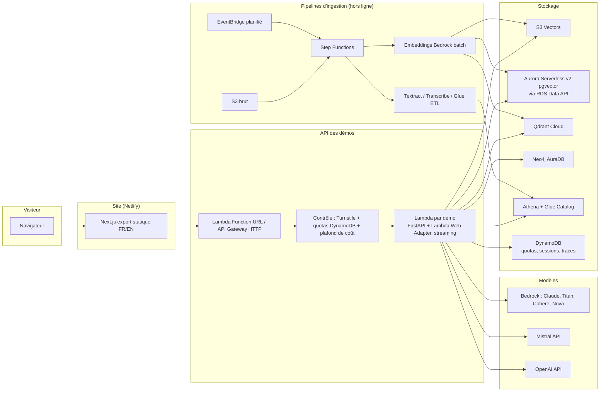

# 03 — Architecture technique

## Principes

1. **Serverless et scale-to-zero partout** : le site doit coûter presque rien quand personne ne s'en sert.
2. **Un socle commun, dix démos** : quotas, streaming, citations, traces, évaluation sont codés une seule fois.
3. **Même contrat d'API pour toutes les démos** : le front ne connaît qu'un seul format de réponse.
4. **Ingestion séparée de l'interrogation** : l'ingestion est un pipeline de données (batch, rejouable, idempotent) ; l'interrogation est une API légère.
5. **Tout en Terraform**, rien de créé à la main dans la console (sauf l'activation des modèles Bedrock et le compte lui-même).

## Schéma global



## Stack

| Couche | Choix | Pourquoi |
|---|---|---|
| Front | **Next.js** (App Router, majoritairement statique), TypeScript, Tailwind, i18n `/fr` `/en`, hébergé sur **Netlify** | Choix de l'utilisateur ; offre gratuite, déploiement depuis GitHub, Netlify Forms pour le contact |
| API | **Python 3.12**, **FastAPI** dans **Lambda** (image conteneur) avec **Lambda Web Adapter** | Le runtime Python managé de Lambda ne stream pas les réponses ; le Web Adapter le permet |
| Exposition | Lambda Function URL (streaming), CORS limité au domaine du site | Pas de coût fixe ; API Gateway REST ne stream pas aussi bien |
| Orchestration ingestion | **Step Functions** (+ Distributed Map pour le volume), **EventBridge Scheduler** | Visualisable, rejouable, cœur du programme DEA |
| Transformation | Lambda, **Glue ETL** (PySpark) pour le tabulaire, Textract, Transcribe | Selon le type de document |
| Stockage vectoriel | **S3 Vectors** (par défaut), **pgvector** sur Aurora Serverless v2 (démo 02), **Qdrant** (09), **Neo4j** (08) | Montrer qu'on sait choisir ; S3 Vectors = coût minimal |
| Métadonnées / état | **DynamoDB** à la demande | Quotas, sessions d'upload, traces, tickets |
| Catalogue | **Glue Data Catalog** | Tables Athena (04, 05, 08) + métadonnées documents |
| LLM | **Bedrock** (Claude Haiku par défaut, Claude Sonnet pour les tâches difficiles, Amazon Nova pour le très bas coût), **Mistral** (09), **OpenAI** (07) | Bedrock principal, deux fournisseurs externes demandés par le marché |
| Embeddings | Titan Text Embeddings v2 (par défaut), Cohere Embed multilingue (comparaison), Mistral Embed (09) | Coût très bas, multilingue |
| Reranking | Cohere Rerank / Amazon Rerank via Bedrock | Démo 02, 03 |
| Frameworks RAG | Code maison léger + **LangGraph** (07) + **LlamaIndex** (au moins une démo) | Les offres citent LangChain/LangGraph ; un code maison lisible montre qu'on comprend ce qu'il y a dessous |
| Observabilité | Traces maison dans DynamoDB + CloudWatch ; **Langfuse Cloud** (offre gratuite, UE) en option | Afficher les coulisses de chaque réponse sur le site |
| Évaluation | Banc maison + **RAGAS** pour les métriques de génération | Les offres sérieuses exigent des jeux d'évaluation |
| IaC | **Terraform** ≥ 1.10 (état dans S3 avec verrou natif `use_lockfile`) | Plus demandé que CDK dans les offres |
| CI/CD | **GitHub Actions** avec **OIDC** vers AWS (pas de clé d'accès stockée) | Dépôt public : aucun secret |
| Outillage Python | `uv`, `ruff`, `mypy`, `pytest` | Standard actuel |

> Les identifiants exacts des modèles et leur disponibilité dans la région doivent être vérifiés au démarrage (Phase 0) : l'offre Bedrock évolue vite.

## Région AWS

Préférence : **eu-west-3 (Paris)** pour l'argument « hébergé en France », sinon **eu-west-1 (Irlande)** ou **eu-central-1 (Francfort)**. Critère décisif : disponibilité de **S3 Vectors**, des **Bedrock Knowledge Bases** et des modèles voulus (éventuellement via profils d'inférence inter-régions « EU »). À trancher en Phase 0, voir [06-decisions.md](06-decisions.md).

## Structure du dépôt (monorepo)

```
/
├── CLAUDE.md
├── README.md
├── docs/                      # ce plan
├── web/                       # site Next.js
│   ├── app/[locale]/...       # pages FR/EN
│   ├── components/demo/       # lecteur de démo commun (chat, citations, coulisses)
│   └── content/demos/         # fiches de démo (MDX FR/EN)
├── packages/
│   └── rag_core/              # bibliothèque Python partagée
│       ├── api/               # contrat d'API, streaming, erreurs
│       ├── guard/             # Turnstile, quotas, plafond de coût
│       ├── llm/               # client unifié Bedrock / Mistral / OpenAI
│       ├── retrieval/         # hybride, RRF, rerank
│       ├── reliability/       # answerability, contrôle de fondement, refus (vérificateurs interchangeables)
│       ├── tracing/           # traces, coût par requête
│       └── eval/              # banc d'évaluation
├── demos/
│   ├── 01-assistant-entrepreneurs/
│   │   ├── ingestion/         # pipeline (Step Functions + Lambdas)
│   │   ├── api/               # handler de la démo
│   │   ├── eval/              # questions de référence + résultats
│   │   ├── infra/             # module Terraform de la démo
│   │   └── README.md          # cas client, choix, résultats, coûts
│   └── ... 02 à 10
├── infra/
│   ├── bootstrap/             # backend Terraform, rôle OIDC GitHub
│   ├── modules/               # modules réutilisables (lambda_api, step_function, s3_vectors...)
│   └── envs/prod/             # assemblage
└── .github/workflows/
```

## Contrat d'API commun

`POST /demos/{id}/ask` — corps : `{ question, locale, session_id, turnstile_token, options }`.

Réponse en flux (Server-Sent Events) :

| Événement | Contenu |
|---|---|
| `status` | étape en cours (« recherche », « reranking », « génération », « réveil de la base »…) |
| `token` | morceau de texte de la réponse |
| `citation` | `{ id, doc_title, location (page, article, timestamp), snippet, url, score }` |
| `artifact` | contenu riche : tableau, graphique, requête SQL, image de figure |
| `trace` | chunks récupérés, scores, modèles, latences, tokens, **coût en €** |
| `done` / `error` | fin ou erreur (dont `quota_exceeded`, `budget_paused`) |

## Protection contre les abus et maîtrise des coûts

1. **Cloudflare Turnstile** (gratuit) vérifié côté serveur à l'ouverture de session.
2. **Quotas** dans DynamoDB : par IP hachée et par jour (ex. 15 questions, moins sur la démo 07), par session, et taille max des questions.
3. **Plafond de coût global** : chaque requête ajoute son coût calculé à un compteur journalier ; au-delà du plafond (ex. 0,80 €/jour), les démos passent en mode « réponses en cache / revenez demain ».
4. **AWS Budgets** avec alertes à 50 %, 80 %, 100 % et action automatique qui coupe les Lambdas des démos.
5. **Concurrence réservée** limitée sur chaque Lambda.
6. **Cache** des questions d'exemple (réponses précalculées) : la plupart des visiteurs cliquent sur les exemples.
7. Pas de WAF payant au départ (≥ 5 $/mois) ; à ajouter si abus constaté.

## Budget mensuel estimé (fonctionnement)

| Poste | Estimation |
|---|---|
| Nom de domaine (amorti, DNS via Netlify) | ~1 € |
| Hébergement du site (Netlify, offre gratuite) | 0 € |
| Lambda, Step Functions, API | ~0 € (offre gratuite) |
| DynamoDB à la demande | < 0,50 € |
| S3 Vectors (toutes démos, ~5 Go) | ~1 € |
| Aurora Serverless v2 en veille (stockage) | ~1 € |
| Athena + Glue (mises à jour) | ~1 € |
| CloudWatch Logs (rétention 14 jours) | ~1 € |
| Appels LLM (plafonnés à ~0,80 €/jour) | ≤ 24 € (souvent bien moins) |
| Qdrant, Neo4j, Langfuse, Turnstile | 0 € (offres gratuites) |
| **Total** | **≈ 8 € en usage faible, ≤ 30 € au plafond** |

Coûts ponctuels d'ingestion (une fois) : environ 70 à 120 € pour les 10 démos, dont l'essentiel sur 03, 06, 08 et 10. À réduire en limitant les corpus si nécessaire.

**Financement par les crédits AWS.** Les crédits Free Tier (100 $ à l'inscription + jusqu'à 100 $ en réalisant des activités : budget, Bedrock, Lambda, RDS, EC2) servent en priorité à payer ces ingestions. Règles :
- Faire les ingestions coûteuses **avant l'expiration des crédits** (12 mois après l'ouverture du compte).
- Les services AWS « maison » (Textract, Transcribe, Glue, Titan, Nova) sont les plus susceptibles d'être couverts ; pour Claude sur Bedrock (modèle tiers), vérifier sur la facture avant de lancer une grosse ingestion. Si Claude n'est pas couvert, utiliser **Amazon Nova** pour les tâches d'ingestion en masse (contextualisation, extraction de graphe, description d'images).
- Le compte doit être en **Paid plan** avant la mise en ligne publique : un compte en Free plan est suspendu au bout de 6 mois ou dès que les crédits sont épuisés, ce qui couperait le site.

## Pièges à éviter (coûts cachés)

- **NAT Gateway** (~35 €/mois) : aucune Lambda dans un VPC ; Aurora interrogé par Data API.
- **Endpoints VPC** (~8 €/mois chacun) : même raison.
- **OpenSearch Serverless** (plusieurs centaines d'€/mois au minimum) : exclu, mentionné sur le site comme option « client à fort volume ».
- **Secrets Manager** (0,40 $/secret/mois) : préférer SSM Parameter Store SecureString.
- **Logs sans rétention** : toujours fixer une rétention.
- **Glue Crawlers planifiés** inutilement : les lancer depuis les pipelines, pas en boucle.
