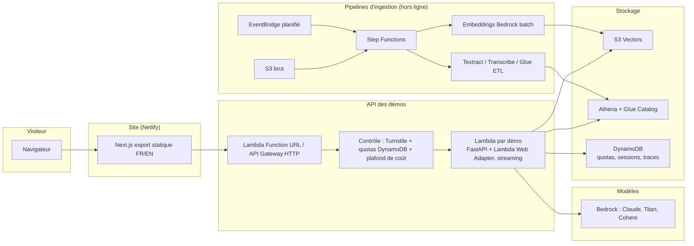

# 03 — Architecture technique

## Principes

1. **Le site ne fait tourner aucun RAG (D-020)** : il rejoue des sessions réelles enregistrées. Coût récurrent ≈ 0 €.
2. **La stack de chaque réalisation est choisie pour son cas et pour les mots-clés à démontrer (D-022)** : AWS, Azure, GCP ou sur site, avec LangChain, LlamaIndex, Haystack ou sans framework.
3. **Un seul format de sortie pour toutes les réalisations** : le flux d'événements du contrat commun. C'est lui qu'on enregistre et que le site rejoue.
4. **Ingestion séparée de l'interrogation** : l'ingestion est un pipeline de données (batch, rejouable, idempotent) ; l'interrogation est une API ou un script léger.
5. **Déployable, mais pas déployé en permanence** : l'infrastructure cloud est décrite en Terraform (AWS, et Azure/GCP quand c'est utile), déployée le temps d'ingérer, d'enregistrer et de mesurer, puis détruite. Les réalisations locales démarrent par `docker compose up`.

## Rejeu des sessions (D-020)

1. **Enregistrement** : un script commun (`rag_core.recording`, à écrire) envoie les questions d'exemple à la réalisation et horodate chaque événement reçu. Il produit un fichier JSON par question et par langue, avec en en-tête la date, les modèles, la stack et le coût total mesuré. Fichiers versionnés dans `web/content/recordings/NN-…/`.
2. **Rejeu** : le lecteur du site lit le fichier et réémet les événements avec leur rythme d'origine (accélérable). Citations cliquables, artifacts et coulisses fonctionnent comme en direct.
3. **Vidéo** : un script Playwright ouvre la fiche, lance le rejeu et filme l'écran, en FR et en EN. Sortie MP4/WebM courte et légère, servie par Netlify.
4. **Mode direct sur rendez-vous** : la même API, lancée en local ou déployée temporairement. Le lecteur s'y connecte quand une URL d'API est configurée.

### Format d'un enregistrement (version 1)

Un fichier par question et par langue : `web/content/recordings/<NN-nom>/<question_id>.<locale>.json`.

```json
{
  "version": 1,
  "demo": "05",
  "locale": "fr",
  "question_id": "q1-schema-pompe",
  "question": "…",
  "variant": "ocr_figures",
  "recorded_at": "2026-11-03T14:12:00Z",
  "stack": { "cloud": ["AWS"], "framework": [], "models": ["Claude Haiku 5.5"], "vector_store": ["S3 Vectors"] },
  "duration_ms": 6120,
  "cost_eur": 0.0013,
  "events": [
    { "t": 0,    "type": "status",   "data": { "step": "retrieval", "label": "Recherche dans 3 450 pages" } },
    { "t": 840,  "type": "citation", "data": { "id": 1, "doc_title": "…", "location": "p. 12", "snippet": "…", "url": "…", "score": 0.82 } },
    { "t": 1210, "type": "token",    "data": { "text": "La procédure…" } },
    { "t": 6050, "type": "trace",    "data": { "chunks": [], "models": [], "latency_ms": 6050, "tokens": {}, "cost_eur": 0.0013 } },
    { "t": 6120, "type": "done",     "data": {} }
  ]
}
```

- `t` : millisecondes depuis le début de la session. Le lecteur respecte ces écarts, avec une vitesse réglable (×1, ×2, instantané).
- `type` et `data` : exactement les événements du contrat commun ci-dessous.
- `variant` (facultatif) : la voie comparée quand la réalisation en a plusieurs (ex. 05 : `ocr_text`, `ocr_figures`, `visual`, `colqwen` ; 08 : le rôle choisi).
- Les fichiers sont produits uniquement par le script d'enregistrement, à partir d'un vrai passage. Jamais écrits à la main.

## Diffusion des réalisations

| Réalisation | Où elle tourne pour l'enregistrement | Après l'enregistrement |
|---|---|---|
| 01, 04, 05 | AWS (Terraform) | `terraform destroy` ; données sources et index gardés sur le poste |
| 02, 07, 08 | Poste local (Docker, Ollama, GPU) | Rien à arrêter |
| 03 | Poste local + Textract ponctuel | Rien à arrêter |
| 06 | Azure (essai 30 jours) | Ressources supprimées avant la fin de l'essai |
| 09 | GCP (essai 90 jours) + Whisper local | Ressources supprimées avant la fin de l'essai |

## Schéma global (réalisations AWS, en mode direct)

Ce schéma décrit les réalisations AWS (01, 04, 05) quand elles sont déployées. Le site public, lui, ne fait que rejouer des enregistrements (voir plus haut).



## Stack

| Couche | Choix | Pourquoi |
|---|---|---|
| Front | **Next.js** (App Router, majoritairement statique), TypeScript, Tailwind, i18n `/fr` `/en`, hébergé sur **Netlify** | Choix de l'utilisateur ; offre gratuite, déploiement depuis GitHub, Netlify Forms pour le contact |
| API | **Python 3.12**, **FastAPI** dans **Lambda** (zip arm64 + couche **Lambda Web Adapter**, D-017) | Le runtime Python managé de Lambda ne stream pas les réponses ; le Web Adapter le permet |
| Exposition | Lambda Function URL (streaming), CORS limité au domaine du site | Pas de coût fixe ; API Gateway REST ne stream pas aussi bien |
| Orchestration ingestion | **Step Functions** (+ Distributed Map pour le volume), **EventBridge Scheduler** | Visualisable, rejouable, cœur du programme DEA |
| Transformation | Lambda, **Glue ETL** (PySpark) pour le tabulaire, Textract, Transcribe | Selon le type de document |
| Stockage vectoriel | **S3 Vectors** (01, 04, 05), **Weaviate** (02), **FAISS** (03), **Azure AI Search** (06), **Neo4j** (07), **Qdrant** (08), **pgvector** (09) | Montrer qu'on sait choisir (D-022) |
| Clouds | **AWS** (01, 03, 04, 05), **Azure** (06), **GCP** (09), sur site / local (02, 03, 07, 08) | Couvrir les trois clouds demandés et le sur-site |
| Métadonnées / état | **DynamoDB** à la demande | Quotas, sessions d'upload, traces, tickets |
| Catalogue | **Glue Data Catalog** | Tables Athena (04, 07) + métadonnées documents |
| LLM | **Claude** via Bedrock (01, 04, 05, comparaison en 03), **GPT** (02 via OpenAI, 06 via Azure OpenAI), **Llama** (03, 07, via Ollama), **Mistral** (07, 08, via Ollama), **Gemini** (09), **Granite / Granite Guardian** (02, 08) | Couvrir les familles de modèles demandées (D-022) |
| Embeddings | Titan Text v2 et Cohere (AWS), modèles open-source en local (bge-m3 ou équivalent), Azure OpenAI (06), Vertex AI (09) | Selon la stack de chaque réalisation |
| Reranking | Cross-encoder open-source en local (02), Cohere Rerank via Bedrock si besoin | Démo 02, 03 |
| Frameworks RAG | **Haystack** (02, 09), **LlamaIndex** (03, 07), **LangChain / LangGraph** (06, 08), sans framework (01, 04, 05) | Les trois frameworks des offres ; le code sans framework montre qu'on comprend ce qu'il y a dessous |
| Exécution locale | **Docker Compose**, **Ollama**, GPU RTX 2080 SUPER 8 Go | Gratuit ; argument « sur site » |
| Observabilité | Traces maison dans DynamoDB + CloudWatch ; **Langfuse Cloud** (offre gratuite, UE) en option | Afficher les coulisses de chaque réponse sur le site |
| Évaluation | Banc maison + **RAGAS** pour les métriques de génération | Les offres sérieuses exigent des jeux d'évaluation |
| IaC | **Terraform** ≥ 1.10 (état dans S3 avec verrou natif `use_lockfile`) | Plus demandé que CDK dans les offres |
| CI/CD | **GitHub Actions** avec **OIDC** vers AWS (pas de clé d'accès stockée) | Dépôt public : aucun secret |
| Outillage Python | `uv`, `ruff`, `mypy`, `pytest` | Standard actuel |

> Les identifiants exacts des modèles et leur disponibilité dans la région doivent être vérifiés au démarrage (Phase 0) : l'offre Bedrock évolue vite.

## Région AWS

Préférence : **eu-west-3 (Paris)** pour l'argument « hébergé en France », sinon **eu-west-1 (Irlande)** ou **eu-central-1 (Francfort)**. Critère décisif : disponibilité de **S3 Vectors**, des **Bedrock Knowledge Bases** et des modèles voulus (éventuellement via profils d'inférence inter-régions « EU »). À trancher en Phase 0, voir [06-decisions.md](06-decisions.md).

## Structure du dépôt (monorepo)

```
/
├── CLAUDE.md
├── README.md
├── docs/                      # ce plan
├── web/                       # site Next.js
│   ├── app/[locale]/...       # pages FR/EN
│   ├── components/demo/       # lecteur commun (rejeu des sessions, citations, coulisses)
│   ├── content/demos/         # fiches des réalisations (MDX FR/EN)
│   └── content/recordings/    # sessions enregistrées (JSON) et vidéos, par réalisation
├── packages/
│   └── rag_core/              # bibliothèque Python partagée
│       ├── api/               # contrat d'API, streaming, erreurs
│       ├── guard/             # Turnstile, quotas, plafond de coût
│       ├── llm/               # client unifié Bedrock / Mistral / OpenAI
│       ├── retrieval/         # hybride, RRF, rerank
│       ├── reliability/       # answerability, contrôle de fondement, refus (vérificateurs interchangeables)
│       ├── tracing/           # traces, coût par requête
│       └── eval/              # banc d'évaluation
├── demos/
│   ├── 01-assistant-entrepreneurs/
│   │   ├── src/assistant_entrepreneurs/
│   │   │   ├── ingestion/     # conversion, synchronisation S3 (étape Lambda du pipeline)
│   │   │   └── api/           # application FastAPI de la démo
│   │   ├── tests/
│   │   ├── eval/              # questions de référence + résultats
│   │   ├── infra/             # module Terraform de la démo (dont la machine à états)
│   │   ├── scripts/           # construction du paquet Lambda
│   │   └── README.md          # cas client, choix, résultats, coûts
│   └── ... 02 à 09
├── infra/
│   ├── bootstrap/             # backend Terraform, rôle OIDC GitHub
│   ├── modules/               # modules réutilisables (lambda_api, step_function, s3_vectors...)
│   └── envs/prod/             # assemblage
└── .github/workflows/
```

## Contrat d'API commun

`POST /demos/{id}/ask` — corps : `{ question, locale, session_id, turnstile_token, options }`.

Réponse en flux (Server-Sent Events) :

| Événement | Contenu |
|---|---|
| `status` | étape en cours (« recherche », « reranking », « génération », « réveil de la base »…) |
| `token` | morceau de texte de la réponse |
| `citation` | `{ id, doc_title, location (page, article, timestamp), snippet, url, score }` |
| `artifact` | contenu riche : tableau, graphique, requête SQL, image de figure |
| `trace` | chunks récupérés, scores, modèles, latences, tokens, **coût en €** |
| `done` / `error` | fin ou erreur (dont `quota_exceeded`, `budget_paused`) |

## Protection contre les abus et maîtrise des coûts (mode direct uniquement)

Depuis D-020, ces protections ne servent qu'au mode direct (rendez-vous ou déploiement temporaire). Le code existe dans `rag_core.guard` et reste utilisable.

1. **Cloudflare Turnstile** (gratuit) vérifié côté serveur à l'ouverture de session.
2. **Quotas** dans DynamoDB : par IP hachée et par jour (ex. 15 questions, moins sur la démo 06), par session, et taille max des questions.
3. **Plafond de coût global** : chaque requête ajoute son coût calculé à un compteur journalier ; au-delà du plafond (ex. 0,80 €/jour), les démos passent en mode « réponses en cache / revenez demain ».
4. **AWS Budgets** avec alertes à 50 %, 80 %, 100 % et action automatique qui coupe les Lambdas des démos.
5. **Concurrence réservée** limitée sur chaque Lambda.
6. **Cache** des questions d'exemple (réponses précalculées) : la plupart des visiteurs cliquent sur les exemples.
7. Pas de WAF payant au départ (≥ 5 $/mois) ; à ajouter si abus constaté.

## Budget (D-020)

**Récurrent : ≈ 1 €/mois** (nom de domaine). Netlify est gratuit, et aucun RAG ne tourne en permanence.

**Ponctuel (construction, enregistrement, mesure)** :

| Réalisation | Payé par | Estimation |
|---|---|---|
| 01, 04, 05 (AWS) | Crédits AWS | ≈ 25 € au total (dont ≈ 19 € pour la 05) |
| 03 (Textract ponctuel) | Crédits AWS | ≈ 5 à 15 € |
| 02 (GPT) | Carte bancaire, API OpenAI | quelques euros |
| 06 (Azure) | Essai Azure (200 $, 30 jours) | 0 € si la fenêtre suffit |
| 09 (GCP) | Essai GCP (300 $, 90 jours) | 0 € |
| 07, 08 (local) | — | 0 € (électricité et temps de calcul) |

L'ancien budget « ≤ 30 €/mois en ligne » reste la référence si une réalisation est un jour ouverte en direct au public.

**Financement par les crédits AWS.** Les crédits Free Tier (100 $ à l'inscription + jusqu'à 100 $ en réalisant des activités : budget, Bedrock, Lambda, RDS, EC2) servent en priorité à payer ces ingestions. Règles :
- Faire les ingestions coûteuses **avant l'expiration des crédits** (12 mois après l'ouverture du compte).
- Les services AWS « maison » (Textract, Transcribe, Glue, Titan, Nova) sont les plus susceptibles d'être couverts ; pour Claude sur Bedrock (modèle tiers), vérifier sur la facture avant de lancer une grosse ingestion. Si Claude n'est pas couvert, utiliser **Amazon Nova** pour les tâches d'ingestion en masse (contextualisation, extraction de graphe, description d'images).
- Passer en **Paid plan** avant les ingestions coûteuses (D-011) : un compte en Free plan est suspendu dès que les crédits sont épuisés. Depuis D-020, le site ne dépend plus d'AWS : une suspension ne le couperait pas.

## Pièges à éviter (coûts cachés)

- **NAT Gateway** (~35 €/mois) : aucune Lambda dans un VPC ; Aurora interrogé par Data API.
- **Endpoints VPC** (~8 €/mois chacun) : même raison.
- **OpenSearch Serverless** (plusieurs centaines d'€/mois au minimum) : exclu, mentionné sur le site comme option « client à fort volume ».
- **Secrets Manager** (0,40 $/secret/mois) : préférer SSM Parameter Store SecureString.
- **Logs sans rétention** : toujours fixer une rétention.
- **Glue Crawlers planifiés** inutilement : les lancer depuis les pipelines, pas en boucle.
